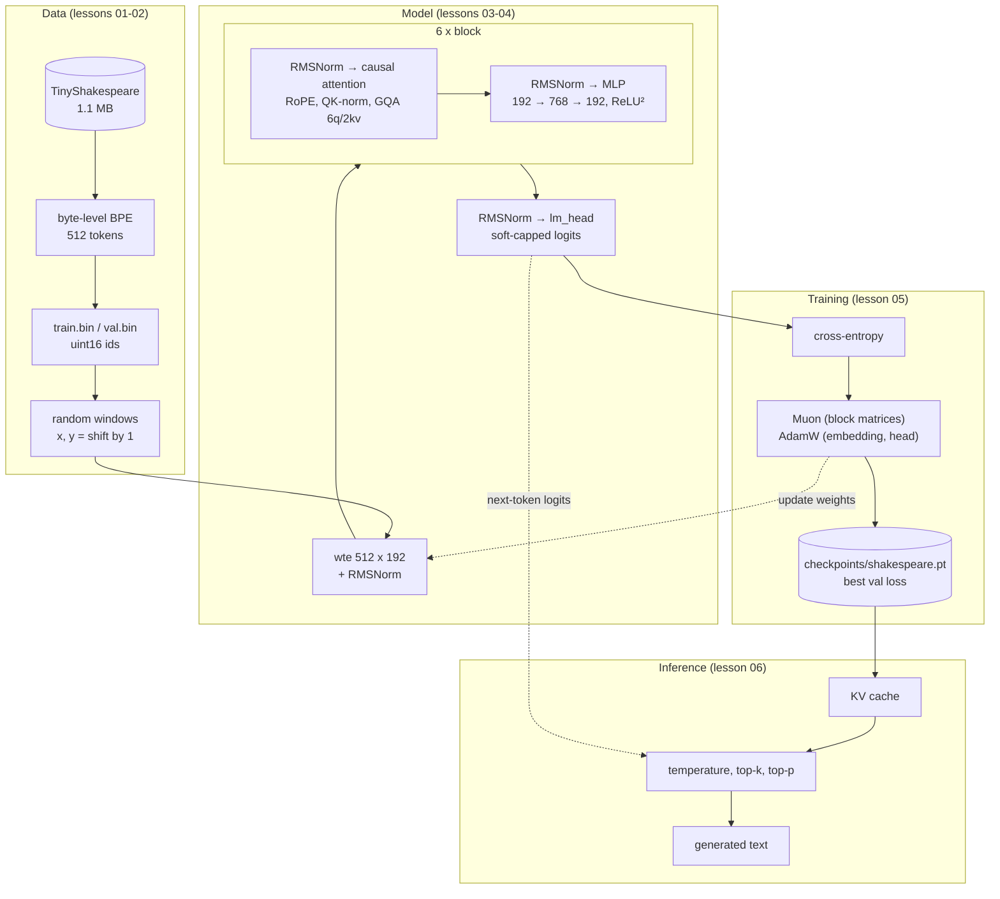

# llm-from-scratch

Build and train a small GPT-style language model from nothing but PyTorch, on a laptop,
in about five minutes. Every stage is here and readable: a byte-level BPE tokenizer, the
data pipeline, a decoder-only transformer with the design choices current open models
use, a training loop with the Muon optimizer, and KV-cached sampling.

The point is to see the whole machine run end to end and watch the loss actually drop,
then understand which parts change (and which don't) at production scale.

```text
step     0 | val 6.2385 | ppl  512.09      <- a uniform guess over 512 tokens: ln(512)
step   100 | val 3.5772 | ppl   35.77
step   200 | val 3.1434 | ppl   23.18
step   300 | val 3.0557 | ppl   21.24
step   400 | val 3.0044 | ppl   20.17
done in 296s                             <- Apple M1, MPS backend
```

```text
ROMEO:
Tybalt, that dear sin is all integrity,
Till down still deep; and, to remember itself.
But if it be were a holding counsels,
The bones of guilty sworn and blood,
And bear the time to smiles and such act,
For this being so stew the world's hope to come.
```

## Quick start

Needs [mise](https://mise.jdx.dev) (it installs the pinned Python and uv). Runs on an
Apple Silicon Mac's GPU (MPS), an NVIDIA GPU, or CPU. No Docker, no API keys.

```bash
mise install          # Python 3.13 + uv
mise run setup        # uv sync: torch, numpy, regex, pytest, ruff
mise run data         # download TinyShakespeare (SHA-256 pinned), train tokenizer, tokenise
mise run train        # ~5 min on an M1; writes checkpoints/shakespeare.pt
mise run sample       # generate text from the checkpoint
mise run test         # ruff + 10 CPU tests (tokenizer, causality, KV cache, overfit)
```

Every config field is also a CLI flag:

```bash
uv run python -m tinyllm.train --run adamw --optimizer adamw
uv run python -m tinyllm.train --run deep --n-layer 8 --max-steps 600
uv run python -m tinyllm.sample --prompt "JULIET:\n" --top-p 0.9 --seed 3
```

## Lessons

Read on GitHub in order. Each links to the code it explains and ends with a diagram.

| # | Lesson | You learn |
|---|---|---|
| 00 | [Overview](docs/00-overview.md) | what a decoder-only LLM is; GPT-2 vs 2026 recipe |
| 01 | [Tokenizer](docs/01-tokenizer.md) | byte-level BPE, trained here in 15 s |
| 02 | [Data and batching](docs/02-data-and-batching.md) | next-token targets, train/val split, tokens per parameter |
| 03 | [Embeddings and RoPE](docs/03-embeddings-and-rope.md) | token vectors and rotary positions |
| 04 | [Attention and blocks](docs/04-attention-and-blocks.md) | causal SDPA, GQA, QK-norm, ReLU² MLP, pre-norm residuals |
| 05 | [Training](docs/05-training.md) | cross-entropy, Muon vs AdamW, WSD schedule, over-fitting |
| 06 | [Sampling and the KV cache](docs/06-sampling-and-kv-cache.md) | temperature, top-k/p, 3x faster decoding |
| 07 | [From tiny to production](docs/07-from-tiny-to-production.md) | SFT, RL, FSDP, serving, what nanochat adds |

## The model

| | |
|---|---|
| Parameters | 2,555,904 |
| Layers / width / heads | 6 / 192 / 6 query heads, 2 KV heads (head dim 32) |
| Context | 256 tokens (~520 characters) |
| Vocabulary | 512 byte-level BPE tokens |
| Data | TinyShakespeare, 547 k tokens (90 / 10 split) |
| Training | 400 steps x 8,192 tokens (3.3 M, ~6.7 epochs), Muon + AdamW, weight decay 0.1, warmup-stable-decay |

## Layout

```text
src/tinyllm/
  config.py     ModelConfig, TrainConfig, device choice
  tokenizer.py  byte-level BPE: train, encode, decode, save
  data.py       download + checksum, tokenise to .bin, random batches
  model.py      RoPE, attention, MLP, block, GPT, KVCache
  train.py      optimizers, LR schedule, eval, checkpointing
  sample.py     temperature / top-k / top-p, KV-cached generation
tests/          fast CPU tests for every stage
scripts/        bench_kv.py, scan-secrets.sh
docs/           the lessons
```

`data/`, `checkpoints/` and `runs/` are created locally and git-ignored.

## Sources

The design follows Karpathy's [nanochat](https://github.com/karpathy/nanochat) (2025)
and the open-model recipe documented in the [Llama 3](https://arxiv.org/abs/2407.21783)
and [DeepSeek-V3](https://arxiv.org/abs/2412.19437) reports. The Muon optimizer is
`torch.optim.Muon` from PyTorch 2.14. Paper links are in each lesson.

## Architecture


