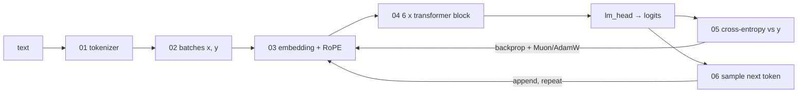

# 00 · What a decoder-only LLM is

A large language model is a function that takes a sequence of tokens and returns a
probability for every possible next token. Generation is that function called in a
loop: pick a token, append it, call again. Training is adjusting the function's weights
so that on real text, the probability it gives to the token that actually came next is
as high as possible.

That's the whole idea. This lab builds each part by hand, small enough to train on a
laptop in minutes, using the same design choices as current open models.

## The stages you'll build

| # | Lesson | Question it answers |
|---|---|---|
| 01 | [Tokenizer](01-tokenizer.md) | How does text become integers? |
| 02 | [Data and batching](02-data-and-batching.md) | What exactly is the model trained to predict? |
| 03 | [Embeddings and RoPE](03-embeddings-and-rope.md) | How do integers become vectors, and how does the model know word order? |
| 04 | [Attention and blocks](04-attention-and-blocks.md) | How does each token use the tokens before it? |
| 05 | [Training](05-training.md) | How does the loss go down, and how do you know it's working? |
| 06 | [Sampling and the KV cache](06-sampling-and-kv-cache.md) | How does a trained model write text, quickly? |
| 07 | [From tiny to production](07-from-tiny-to-production.md) | What changes at a billion parameters? |

## Why "decoder-only"

The 2017 transformer had an encoder (reads the input) and a decoder (writes the output).
GPT dropped the encoder: one stack of blocks, each position allowed to look only at
earlier positions. That single design turned out to scale best, and every major chat
model today (GPT, Claude, Gemini, Llama, Qwen, DeepSeek, Mistral) is a decoder-only
transformer at its core, sometimes with Mixture-of-Experts MLPs.

## What "modern" means here

This is not a copy of 2019's GPT-2. It follows the recipe that open models converged on
by 2025 and that Karpathy's [nanochat](https://github.com/karpathy/nanochat) uses:

| GPT-2 (2019) | This lab (2026 practice) |
|---|---|
| learned position embeddings | rotary embeddings (RoPE) |
| LayerNorm with gain and bias | parameter-free RMSNorm, pre-norm |
| GELU MLP | ReLU² MLP (Llama uses SwiGLU) |
| full multi-head attention | grouped-query attention + QK-norm |
| bias in every linear layer | no biases |
| tied input/output embeddings | untied, with a logit soft-cap |
| AdamW + cosine schedule | Muon + AdamW, warmup-stable-decay schedule |

## How to read the lessons

Each lesson links to the exact code it explains, gives a command to run, shows the
output you should expect, says what production systems do differently, and ends with
a diagram. Read them in order the first time; the code is short enough
(under 900 lines of Python, comments included) to read alongside.

## Diagram

