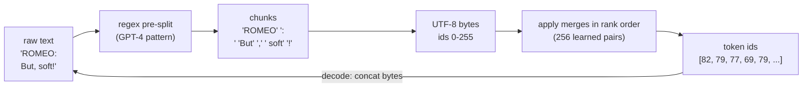

# 01 · Text to tokens: byte-level BPE

A language model never sees letters. It sees integers. The tokenizer decides which
integers, and that choice fixes the model's vocabulary size, how much text fits in the
context window, and what the model can and cannot spell.

Code: [`src/tinyllm/tokenizer.py`](../src/tinyllm/tokenizer.py)

## Run it

```bash
mise run tokenizer      # trains a 512-token BPE on TinyShakespeare in ~15 s
```

You'll see the first merges it learns, then a sample line broken into pieces:

```text
merge    1:            b' t' (seen 23837 times)
merge    2:            b'he' (seen 18203 times)
merge    3:            b' a' (seen 13541 times)
...
sample: 58 bytes -> 32 tokens
pieces: ['R', 'O', 'M', 'E', 'O', ':\n', 'But', ',', ' so', 'f', 't', '!', ' what', ' li', 'ght', ...]
whole corpus: 1,115,394 bytes -> 547,276 tokens (2.04 bytes/token)
```

## How BPE works

1. **Start from bytes.** Ids 0 to 255 are the 256 possible byte values. Any UTF-8 string,
   in any language, with any emoji, is already encodable. There is no "unknown token".
2. **Pre-split with a regex.** Text is chopped into chunks (a word with its leading
   space, a run of digits, punctuation, whitespace) using the same pattern as GPT-4's
   `cl100k_base`. Merges never cross chunk boundaries, so you don't get tokens like
   `"e. T"` that glue the end of one sentence to the start of the next.
3. **Count adjacent pairs and merge the most frequent.** `' '` + `'t'` is the most common
   pair in Shakespeare, so it becomes token 256. Repeat until the vocabulary reaches
   the target size. The ordered list of merges *is* the tokenizer.
4. **Encoding** replays the merges on new text, always applying the earliest-learned
   merge first. **Decoding** just concatenates each token's bytes.

The trainer is fast in pure Python because it counts each distinct chunk once and
weights it by frequency: Shakespeare has 1.1 M characters but only about 15 k unique
chunks.

## What to notice

- **Leading spaces belong to the word.** `' what'` is one token, so the model doesn't
  spend a position on every space.
- **Capitals are expensive.** `ROMEO` is five tokens because shouty speaker names are
  rarer than lower-case words. Bigger vocabularies fix this; ours is tiny on purpose.
- **Compression is the whole point.** 2.04 bytes per token means the 256-token context
  window covers about 520 characters. A character-level model would see half as much
  text for the same compute.
- **The round-trip is exact.** `decode(encode(s)) == s` for any string; the tests check
  unseen Unicode too.

## How production does it

| Here | Production (2026) |
|---|---|
| 512 tokens, pure Python | 32 k to 256 k tokens; nanochat uses 65,536. Llama 3 uses 128 k, Gemma 256 k |
| trained on 1 MB | trained on a multi-GB sample of the pre-training mix |
| no special tokens | `<\|bos\|>`, chat-role markers, tool-call markers added before SFT |
| Python merge loop | Rust trainers (Hugging Face `tokenizers`, nanochat's `rustbpe`) and `tiktoken` for fast inference |

Bigger vocabularies trade a larger embedding table and output layer for shorter
sequences. Since attention cost grows with sequence length, frontier models have moved
steadily toward larger vocabularies.

## Try this

- Change `vocab_size` in [`config.py`](../src/tinyllm/config.py) to 256 (pure bytes) or
  1024 and rerun `mise run tokenizer`. Watch bytes/token change. (Training picks the
  new size up automatically and re-tokenises the data.)
- Encode `"supercalifragilistic"` and see how an unseen word falls back to small pieces.

## Sources

- Sennrich et al., [Neural Machine Translation of Rare Words with Subword Units](https://arxiv.org/abs/1508.07909) (the BPE paper)
- Karpathy, [minbpe](https://github.com/karpathy/minbpe) and [nanochat](https://github.com/karpathy/nanochat) tokenizer
- OpenAI, [tiktoken](https://github.com/openai/tiktoken) (source of the split pattern)

## Diagram


