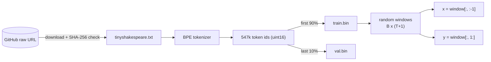

# 02 · Data and batching: next-token prediction

Pre-training has exactly one objective: given tokens 0..t, predict token t+1. Every
capability a base model has comes from getting better at that one guess.

Code: [`src/tinyllm/data.py`](../src/tinyllm/data.py)

## Run it

```bash
mise run data
```

```text
tokenised 547,276 tokens -> train 492,548 / val 54,728
data/tinyshakespeare.txt   1,115,394 bytes
data/tokenizer.json            ...
data/train.bin               985,096 bytes
data/val.bin                 109,456 bytes
```

## What happens

1. **Download, pinned by checksum.** TinyShakespeare comes from Karpathy's char-rnn
   repository and is verified against a SHA-256 before use. If upstream changed the
   file, the lab would stop rather than silently train on different data.
2. **Tokenise once, store compactly.** The whole corpus becomes a flat array of
   `uint16` ids (2 bytes each, enough for a vocabulary under 65,536) written to
   `train.bin` / `val.bin`. A stamp file records which tokenizer produced them, so
   changing the vocabulary re-tokenises automatically.
3. **Split by position, not at random.** The last 10% of the text is the validation
   set. Random windows from one text overlap heavily, so a random split would leak
   training text into validation and make the score look better than it is.
4. **Sample random windows.** `TokenStream.batch` picks `B` random start offsets and
   slices `T+1` tokens from each. Inputs are the first `T`; targets are the same window
   shifted left by one.

```text
window  :  [ROM] [EO] [:\n] [But] [,] [ so] [f] [t] [!]
input  x:  [ROM] [EO] [:\n] [But] [,] [ so] [f] [t]
target y:  [EO]  [:\n] [But] [,] [ so] [f]  [t] [!]
```

So one window of 256 tokens gives 256 training examples at once: position 0 learns to
predict position 1 from one token of context, position 255 learns from 255 tokens of
context. Causal masking (lesson 04) is what keeps each position from peeking at its
own answer.

## How production does it

| Here | Production |
|---|---|
| 1.1 MB, one file | trillions of tokens: web crawls (FineWeb-Edu, DCLM), code, maths, books, synthetic data |
| no cleaning | dedup (exact and fuzzy/MinHash), quality classifiers, PII scrubbing, decontamination against eval sets |
| random windows | documents packed back-to-back with a `<\|bos\|>` separator, often with best-fit packing to avoid wasted padding |
| one `.bin` in RAM | sharded files (parquet or token shards) streamed by many data-loader workers, deterministic and resumable |
| ~7 epochs over the data | usually < 1 epoch; data repetition hurts beyond a few passes |

The ratio that matters is **tokens per parameter**. The Chinchilla result put the
compute-optimal point near 20 tokens per parameter; modern small models train far past
it (Llama 3 8B saw ~1,900 tokens per parameter) because inference is cheaper on a
smaller, over-trained model. Our 2.6 M parameter model sees 3.3 M tokens, about 1.3 per
parameter, and only by repeating a tiny dataset almost 7 times, which is why lesson 05
watches validation loss for over-fitting.

## Sources

- Hoffmann et al., [Training Compute-Optimal Large Language Models](https://arxiv.org/abs/2203.15556) (Chinchilla)
- Penedo et al., [The FineWeb Datasets](https://arxiv.org/abs/2406.17557)
- Karpathy, [char-rnn TinyShakespeare](https://github.com/karpathy/char-rnn/tree/master/data/tinyshakespeare)

## Diagram


