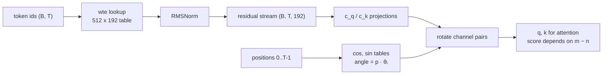

# 03 · Embeddings and rotary positions

Token ids are arbitrary labels: id 291 is not "bigger" than id 82. The first job of
the network is to turn each id into a vector it can do arithmetic on, and to tell
attention where each token sits in the sequence.

Code: [`GPT.__init__`, `rope_tables`, `apply_rope` in `model.py`](../src/tinyllm/model.py)

## Token embedding

`self.wte = nn.Embedding(vocab_size, n_embd)` is a 512 x 192 table. Row *i* is the
learned vector for token *i*. Looking up a batch `(B, T)` of ids gives `(B, T, 192)`.
That 192-wide vector per position is the **residual stream**: every later layer reads
from it and adds its result back into it.

The embedding is immediately RMS-normalised (`norm(self.wte(idx))`), so every token
enters the stack at the same scale no matter how its row drifted during training.

## Why positions need special handling

Attention (lesson 04) compares every query with every key using dot products. Dot
products don't care about order: shuffle the tokens and each pair scores the same.
Without position information, "dog bites man" and "man bites dog" look identical.

GPT-2 fixed this by **adding** a learned position vector to each token embedding. That
works, but it caps the model at the trained length and mixes "what" and "where" into the
same numbers.

## Rotary position embedding (RoPE)

RoPE, used by Llama, Qwen, Mistral, Gemma, DeepSeek and nanochat, rotates the query and
key vectors instead of adding anything:

- Split each 32-wide head vector into 16 pairs of channels.
- Rotate pair *i* at position *p* by the angle `p * θᵢ`, where
  `θᵢ = base^(-2i/d)`. Early pairs spin quickly; late pairs spin slowly, like the hands
  of a clock.
- Rotation preserves length, so it changes **direction only**.

The key property: when a query at position *m* is dotted with a key at position *n*,
the two rotations combine into a rotation by `(m - n)`. **Attention scores depend on
relative distance, not absolute position.** The model learns "the previous token" once
and it works everywhere in the window.

```python
def apply_rope(x, cos, sin):  # x: (B, H, T, D)
    d = x.size(-1) // 2
    x1, x2 = x[..., :d], x[..., d:]
    return torch.cat((x1 * cos + x2 * sin, -x1 * sin + x2 * cos), dim=-1)
```

`cos`/`sin` are computed once for every position up to `seq_len` and stored as
non-persistent buffers: they follow the model to the GPU but aren't saved in the
checkpoint because they can be recomputed.

RoPE is applied to queries and keys only. Values carry content, not position.

## What to notice

- **No parameters.** RoPE adds nothing to learn; the old learned table for 256
  positions x 192 channels is gone.
- **`rope_base`.** 10,000 is the original value. Long-context models raise it
  (Llama 3 uses 500,000; nanochat 100,000) so the slowest pairs don't wrap around within
  the window. Context-extension tricks such as YaRN and NTK scaling work by adjusting
  these frequencies after training.

## Try this

Train with `--rope-base 100` and compare validation loss. Very fast rotations make
distant positions alias onto each other.

## Sources

- Su et al., [RoFormer: Enhanced Transformer with Rotary Position Embedding](https://arxiv.org/abs/2104.09864)
- Peng et al., [YaRN: Efficient Context Window Extension](https://arxiv.org/abs/2309.00071)
- Meta, [The Llama 3 Herd of Models](https://arxiv.org/abs/2407.21783)

## Diagram


