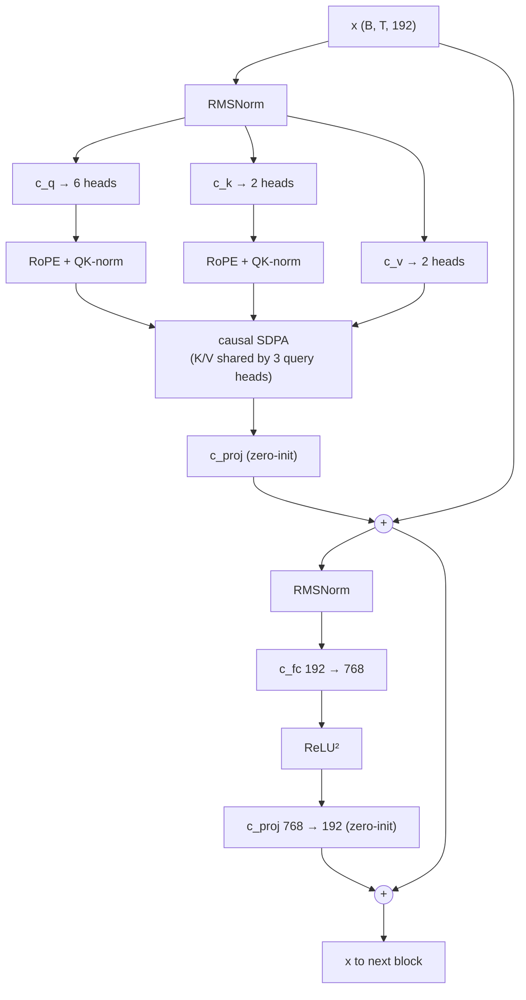

# 04 · Attention and the transformer block

Attention is how a position pulls in information from earlier positions. The block
wraps attention and an MLP in residual connections, and the model is that block
stacked six times.

Code: [`CausalSelfAttention`, `MLP`, `Block` in `model.py`](../src/tinyllm/model.py)

## Causal self-attention, step by step

For each position the layer computes three vectors from the residual stream:

- **query** *q*: what am I looking for?
- **key** *k*: what do I contain?
- **value** *v*: what do I hand over if someone attends to me?

Then for each head:

```text
scores  = q · kᵀ / √d           (T x T: how much each position wants each other one)
scores  = mask out the future    (position t may only see 0..t)
weights = softmax(scores)        (each row sums to 1)
out     = weights · v            (weighted average of earlier values)
```

The future mask is what makes this a **decoder**: when position 10 predicts token 11,
it physically cannot see token 11. `tests/test_tinyllm.py::test_model_is_causal`
proves it by changing a future token and checking that earlier logits don't move.

### Multi-head

With 6 heads of width 32, the layer runs six independent attention patterns in
parallel: one head can track "the previous token", another "the speaker name at the
start of this line". The heads' outputs are concatenated and mixed by `c_proj`.

### The four modern details in this file

1. **Fused kernel.** `F.scaled_dot_product_attention(q, k, v, is_causal=True)` runs the
   whole recipe above without materialising the T x T matrix in memory when a
   FlashAttention-style kernel is available. This is the single biggest practical
   speed-up of the last few years. nanochat uses FlashAttention 3 on Hopper GPUs and
   falls back to this same SDPA call elsewhere.
2. **QK-norm.** Queries and keys are RMS-normalised after RoPE. That bounds every score
   to ±√d, so attention logits can't explode as weights grow. It removes a whole class
   of loss spikes at scale (used in Gemma 3, OLMo 2, Qwen 3, nanochat).
3. **Grouped-query attention (GQA).** 6 query heads share 2 key/value heads (3 queries per
   K/V group). Quality barely changes, but the KV cache used during generation shrinks
   3x. At scale, KV-cache memory is what limits how many users a GPU can serve, which is
   why Llama 3, Mistral, Qwen and most open models use GQA.
4. **No bias terms.** Every `nn.Linear` has `bias=False`. Biases add parameters that
   barely help and complicate some optimizers.

## MLP

```python
self.c_proj(F.relu(self.c_fc(x)).square())  # 192 -> 768 -> 192
```

Attention moves information *between* positions; the MLP processes each position on its
own, and holds most of the parameters. The activation is **ReLU²** (from the Primer
paper; used by nanochat and modded-nanogpt). Llama-family models use **SwiGLU** instead,
a gated variant with three matrices; both clearly beat GPT-2's GELU.

## The block: pre-norm residuals

```python
x = x + self.attn(norm(x), cos, sin, kv_cache)
x = x + self.mlp(norm(x))
```

- **Residual connections** (`x = x + ...`) give gradients a straight path from the loss
  to the embedding, which is what lets deep stacks train at all.
- **Pre-norm** normalises the *input* to each sub-layer, never the residual stream
  itself, so the stream can carry information at any scale.
- **RMSNorm** rescales by the root-mean-square only (no mean subtraction, and here no
  learned gain, as in nanochat). Cheaper than LayerNorm and just as good.
- **Zero-initialised output projections.** `c_proj` in both sub-layers starts at zero,
  so at step 0 every block returns its input unchanged and the network is effectively
  just embedding then head. Blocks "switch on" as they learn.

## The output head

After the last block: a final `norm`, then `lm_head` (192 -> 512) produces one logit per
vocabulary entry. Two details:

- **Untied embeddings.** `lm_head` is a separate matrix from `wte` (GPT-2 shared them).
  Separate matrices cost a little memory and give the model more freedom; most modern
  models untie them.
- **Logit soft-cap.** `15 · tanh(logits / 15)` keeps logits within ±15 smoothly
  (Gemma 2 and nanochat). It stops the model from becoming absurdly over-confident.

`lm_head` is initialised with tiny weights, so every logit starts near zero, the softmax
is uniform, and the first loss is exactly `ln(512) = 6.238`. The training script prints
this expectation and step 0 matches it; if it didn't, initialisation would be broken.

## Parameter count

| Part | Shape | Parameters |
|---|---|---|
| `wte` | 512 x 192 | 98,304 |
| per block: `c_q`, `c_proj` | 2 x 192 x 192 | 73,728 |
| per block: `c_k`, `c_v` (2 KV heads) | 2 x 192 x 64 | 24,576 |
| per block: MLP | 2 x 192 x 768 | 294,912 |
| 6 blocks | | 2,359,296 |
| `lm_head` | 192 x 512 | 98,304 |
| **total** | | **2,555,904** |

## Sources

- Vaswani et al., [Attention Is All You Need](https://arxiv.org/abs/1706.03762)
- Dao, [FlashAttention-2](https://arxiv.org/abs/2307.08691)
- Ainslie et al., [GQA](https://arxiv.org/abs/2305.13245)
- Henry et al., [Query-Key Normalization for Transformers](https://arxiv.org/abs/2010.04245)
- So et al., [Primer](https://arxiv.org/abs/2109.08668) (ReLU²); Shazeer, [GLU Variants](https://arxiv.org/abs/2002.05202) (SwiGLU)
- Karpathy, [nanochat `gpt.py`](https://github.com/karpathy/nanochat/blob/master/nanochat/gpt.py)

## Diagram


