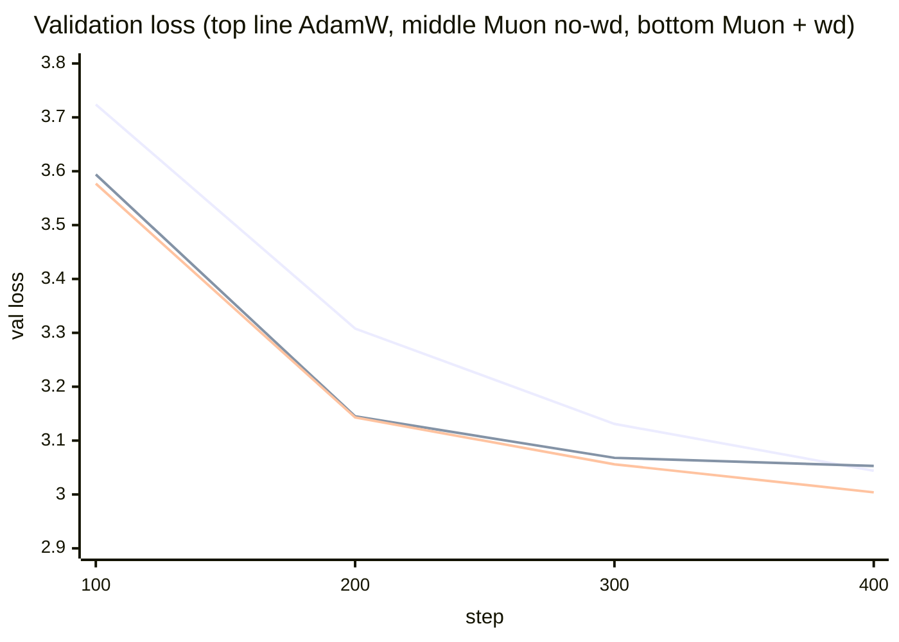
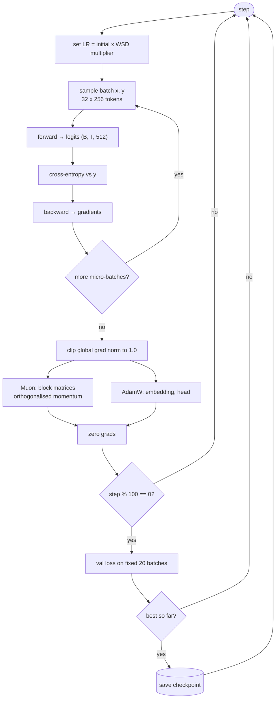

# 05 · Training: making the loss go down

Training repeats four steps a few hundred times: sample a batch, compute how wrong the
predictions are, compute gradients, nudge every weight. This lesson walks through the
loop, the optimizer, the schedule, and how to read the numbers it prints.

Code: [`src/tinyllm/train.py`](../src/tinyllm/train.py)

## Run it

Check nothing heavy is running first (other labs' Docker stacks compete for the same
16 GB), then:

```bash
mise run train        # ~5 min on an M1; writes checkpoints/shakespeare.pt
```

```text
device=mps params=2,555,904 train_tokens=492,548
tokens/step=8,192 total=3,276,800 (~6.7 epochs)
expected loss at step 0: ln(512) = 6.238
step     0 | val 6.2385 | ppl  512.09 | saved
step     0 | loss 6.2383 | lr x0.03 | grad  0.27 | 2,285 tok/s
step    10 | loss 5.7624 | lr x0.37 | grad  1.58 | 8,428 tok/s
step   100 | val 3.5772 | ppl   35.77 | saved
...
step   400 | val 3.0044 | ppl   20.17 | saved
done in 296s; best val loss 3.0044 -> checkpoints/shakespeare.pt
```

## Reading the numbers

- **loss** is cross-entropy: the average of `-ln(probability the model gave to the
  correct next token)`. Lower is better; 0 would mean certainty and always right.
- **Step 0 must equal ln(vocab).** With the output head initialised near zero the model
  spreads probability evenly over 512 tokens, so the loss is exactly `ln(512) = 6.238`.
  This is the first sanity check of any training run. A higher number means the
  initialisation is confidently wrong; a lower one means something leaks the answer.
- **ppl** (perplexity) is `e^loss`: "the model is as unsure as if it were choosing
  uniformly among this many tokens". It falls from 512 to about 20.
- **val vs train.** Train loss is measured on the batch just trained on; val loss on
  held-out text the model never sees. Only val tells you whether it generalises.
- **grad** is the global gradient norm before clipping. A sudden jump is the early
  warning of a loss spike.
- **tok/s** is throughput. The first steps are slow while the Metal kernels compile.

## The loop

```python
for step in range(max_steps):
    set_lr(lr_multiplier(step))  # warmup -> stable -> warmdown
    for _ in range(grad_accum_steps):  # micro-batches add up to one step
        x, y = train_data.batch(...)
        _, loss = model(x, y)
        (loss / grad_accum_steps).backward()
    clip_grad_norm_(model.parameters(), 1.0)  # cap the step size on rare bad batches
    for opt in optimizers:
        opt.step()
    model.zero_grad(set_to_none=True)
```

Every `eval_interval` steps it measures val loss on the **same** 20 batches (fixed seed),
so successive evaluations are comparable, and saves a checkpoint only when val improves.
Metrics go to `runs/<name>/metrics.jsonl` for plotting.

Gradient accumulation lets you train with a larger effective batch than fits in memory:
`--grad-accum-steps 4` gives 32,768 tokens per optimizer step at the same memory cost.

## The optimizer: Muon for matrices, AdamW for the rest

**AdamW** keeps a running mean and variance of each parameter's gradient and scales each
parameter's update individually. It has been the default since 2017.

**Muon** (2024, now `torch.optim.Muon` in PyTorch) treats each weight *matrix* as a
whole. It takes the momentum-smoothed gradient and runs a few Newton-Schulz iterations to
**orthogonalise** it: the update keeps its directions but all of them get equal
magnitude. Plain gradients tend to be dominated by a few directions; orthogonalising lets
the rare directions learn too. It set the records in the modded-nanogpt speed-runs and
was used to train Kimi K2, and nanochat trains with it.

Muon only makes sense for 2-D matrices that transform hidden activations, so
`build_optimizers` splits parameters the way nanochat does:

| Parameters | Optimizer | LR |
|---|---|---|
| every `nn.Linear` inside the 6 blocks | Muon | 0.02 |
| `wte` (embedding lookup table) | AdamW | 0.05 |
| `lm_head` (output) | AdamW | 0.004 |

Weight decay 0.1 (decoupled, as in AdamW) pulls every weight gently toward zero each
step, which acts as a regulariser.

## The schedule: warmup, stable, warmdown (WSD)

```text
lr x1.0 ┤    ┌──────────────────────┐
        │   ╱                        ╲
        │  ╱                          ╲
    0.0 ┼─╯                            ╲__
        0   30                    240     400   step
         warmup      stable          warmdown (last 40%)
```

- **Warmup** (30 steps): Adam-style statistics are noisy at the start; ramping up avoids
  a destructive first few steps.
- **Stable**: the bulk of learning at full rate.
- **Warmdown** to 0 over the last 40%: a decaying LR lets the weights settle into the
  bottom of the valley they're in. Most of the final gain arrives here: watch val drop
  from 3.14 to 3.00 in the last 200 steps.

WSD replaced cosine decay in many 2024+ recipes (MiniCPM, DeepSeek, nanochat) because the
stable phase can be extended or branched from without knowing the total steps up front.

## Experiments, all run on the M1 for this lesson

Same seed, same data, 400 steps unless noted. Validation loss:

| Run | step 100 | step 200 | step 300 | step 400 | train loss at end |
|---|---|---|---|---|---|
| **default** (Muon + AdamW, weight decay 0.1) | 3.577 | 3.143 | 3.056 | **3.004** | 2.11 |
| Muon + AdamW, no weight decay | 3.594 | 3.145 | 3.068 | 3.053 | 2.11 |
| AdamW only (LR 3e-3), no weight decay | 3.724 | 3.308 | 3.131 | 3.044 | 2.46 |
| Muon, no weight decay, **600 steps** | 3.594 | 3.146 | 3.122 | 3.103 (best) | 1.90 (step 500) |



What the table shows:

1. **Muon learns faster.** At step 100 and 200 it is well ahead of AdamW on val, and far
   ahead on train loss (2.11 vs 2.46 at the end). It is the better *optimizer*.
2. **On a tiny dataset, faster fitting means faster memorising.** Without weight decay,
   Muon's lead on val has disappeared by step 400: its train/val gap is 0.95, AdamW's 0.59.
   Adding weight decay 0.1 closes some of that and makes it the best run.
3. **Over-fitting is real and visible.** Run for 600 steps (about 10 epochs) and val loss
   bottoms out at step 400 then climbs (3.18 at 500, 3.23 at 600) while train loss keeps
   falling. That's why the script keeps the best-val checkpoint, not the last one.
   Production runs rarely see this because they almost never repeat data.

Single runs on one seed differ by a few hundredths, so treat gaps that small as noise.

## Why fp32 here

On CUDA you'd wrap the forward pass in `torch.autocast(dtype=torch.bfloat16)` for about
2x speed. On this M1, bf16 and fp16 autocast were both *slower* than fp32 for a model this
small (measured: 10.1 k and 10.8 k tok/s vs 11.6 k), so the lab stays in fp32. The logits
and loss are computed in fp32 regardless, as production code does.

## Try this

```bash
uv run python -m tinyllm.train --run adamw --optimizer adamw --weight-decay 0
uv run python -m tinyllm.train --run long --max-steps 600 --weight-decay 0   # watch it over-fit
uv run python -m tinyllm.train --run wide --n-embd 256 --n-head 8 --n-kv-head 2
uv run python -m tinyllm.train --run hot --matrix-lr 0.08                     # too high?
uv run python -m tinyllm.sample --checkpoint checkpoints/adamw.pt
```

Keep a table like the one above. Comparing runs is most of what training research is.

## Sources

- Jordan et al., [Muon: An optimizer for hidden layers](https://kellerjordan.github.io/posts/muon/) and [modded-nanogpt](https://github.com/KellerJordan/modded-nanogpt)
- Liu et al., [Muon is Scalable for LLM Training](https://arxiv.org/abs/2502.16982) (Moonshot)
- PyTorch, [`torch.optim.Muon`](https://docs.pytorch.org/docs/stable/generated/torch.optim.Muon.html)
- Loshchilov and Hutter, [Decoupled Weight Decay Regularization](https://arxiv.org/abs/1711.05101) (AdamW)
- Hu et al., [MiniCPM](https://arxiv.org/abs/2404.06395) (warmup-stable-decay schedule)

## Diagram


