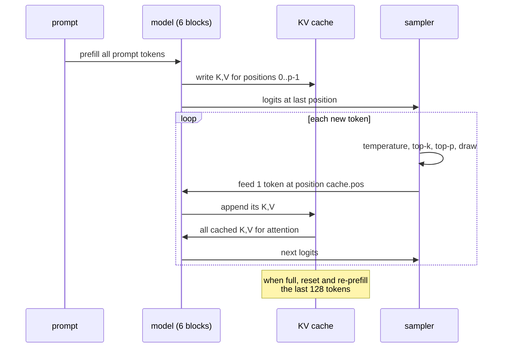

# 06 · Sampling and the KV cache

A trained model only gives you a probability distribution over the next token.
Turning that into text needs two decisions: **which** token to pick from the
distribution, and **how** to avoid recomputing the whole sequence for every new token.

Code: [`src/tinyllm/sample.py`](../src/tinyllm/sample.py), [`KVCache` in `model.py`](../src/tinyllm/model.py)

## Run it

```bash
mise run sample                                                   # ROMEO:, 300 tokens
uv run python -m tinyllm.sample --prompt "JULIET:\n" --seed 7
uv run python -m tinyllm.sample --temperature 0 --tokens 80        # greedy
mise run bench-kv                                                 # cache vs no cache
```

## Choosing the next token

`sample_next` applies these in order to the last position's logits:

| Knob | What it does | Typical |
|---|---|---|
| `temperature` | divides logits before softmax. < 1 sharpens toward the top choice, > 1 flattens toward random. 0 means greedy (always the argmax). | 0.6 to 1.0 |
| `top_k` | keeps only the k highest-scoring tokens | 40 to 100, or off |
| `top_p` (nucleus) | keeps the smallest set of tokens whose probabilities add up to p; adapts to how confident the model is | 0.9 to 0.95 |

Then it draws one token with `torch.multinomial`. A seeded `torch.Generator` makes
runs reproducible.

Try greedy decoding (`--temperature 0 --tokens 300`) and you'll see why nobody ships it
for open-ended text. Ours ends in a loop:

```text
KING RICHARD III:
Why, what say you, Henry, what say you, Henry?
```

Greedy always takes the single most likely continuation, and once a phrase makes itself
more likely, it repeats. A little randomness lets
it leave those loops. Production chat APIs expose the same three knobs; newer
alternatives like min-p (keep tokens with at least p x the top token's probability)
follow the same idea.

## The KV cache

Without a cache, generating token *n* means running the model over all *n* previous
tokens again, and for every one of them recomputing the keys and values that haven't
changed. Total work grows with the square of the output length.

The keys and values for earlier positions **never change** (causal masking means a
position never sees anything after it). So store them:

1. **Prefill.** Run the whole prompt once. Each layer writes its K and V for every
   prompt position into `KVCache`, a pre-allocated tensor of shape
   `(layers, batch, kv_heads, seq_len, head_dim)`.
2. **Decode.** Feed only the newest token. Each layer computes K and V for that one
   position, appends them to the cache, and attends over the full cached history.
   RoPE uses `cache.pos` so the new token gets the right position.

`tests/test_tinyllm.py::test_kv_cache_matches_full_forward` checks that prefill plus
cached single-token steps produce exactly the same logits as one full forward pass.

`mise run bench-kv` on an M1 CPU (250 tokens):

```text
with KV cache   :  0.40s     624 tok/s
without KV cache:  1.20s     208 tok/s
speed-up        : 3.0x
greedy outputs identical for the first 250 tokens: True
```

The gap widens with longer contexts and bigger models, which is why every serving
engine is built around the cache.

### When the window fills up

The model was trained on 256 positions and RoPE tables only go that far. When the cache
is full, `generate` throws it away and re-prefills from the most recent 128 tokens, then
carries on. Production models avoid this by training on long contexts (and stretching
RoPE), and engines evict or compress old cache entries instead.

### Why GQA matters here

The cache stores **K/V heads**, not query heads. With 2 KV heads instead of 6, the cache
is 3x smaller. For a 70 B model serving 128 k-token conversations, the KV cache can
outweigh the model weights, so this reduction is what makes long-context serving
affordable. DeepSeek's multi-head latent attention (MLA) pushes the same idea further by
caching a compressed latent instead of full K/V.

## How production does it

- **Paged KV cache** (vLLM's PagedAttention): cache memory is allocated in fixed-size
  blocks like virtual-memory pages, so many requests of different lengths share one GPU
  without fragmentation, and requests with the same prefix share blocks.
- **Continuous batching**: new requests join the running batch at every decode step
  instead of waiting for the batch to finish.
- **Prefix caching**: system prompts shared across requests are prefilled once.
  Anthropic's and OpenAI's prompt-caching APIs expose this to users.
- **Speculative decoding**: a small draft model proposes several tokens; the big model
  verifies them in one forward pass.
- **Quantised caches**: K/V stored in 8 bits or less.

## Sources

- Holtzman et al., [The Curious Case of Neural Text Degeneration](https://arxiv.org/abs/1904.09751) (nucleus sampling)
- Kwon et al., [Efficient Memory Management for LLM Serving with PagedAttention](https://arxiv.org/abs/2309.06180)
- Leviathan et al., [Fast Inference from Transformers via Speculative Decoding](https://arxiv.org/abs/2211.17192)
- DeepSeek-AI, [DeepSeek-V2](https://arxiv.org/abs/2405.04434) (multi-head latent attention)

## Diagram


