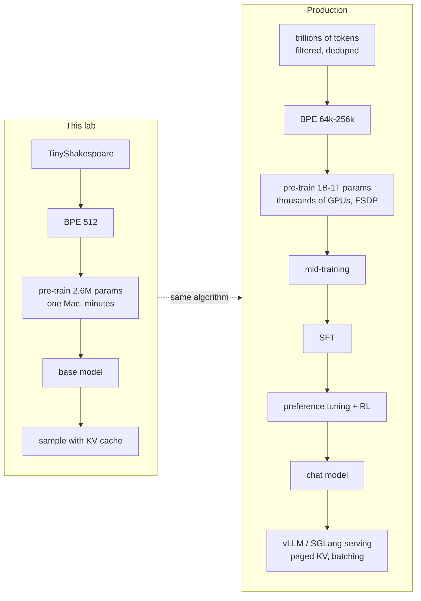

# 07 · From this lab to a production LLM

Everything in lessons 01 to 06 is the real algorithm. A frontier model runs the same
loop: tokenise, embed, attend, predict the next token, step the optimizer. What changes
is scale, and the engineering needed to survive it. This lesson maps each piece of the
lab to what production training stacks do in 2026.

## The full pipeline, not just pre-training

This lab stops at a **base model**: it continues text. A chat assistant needs more
stages after pre-training:

| Stage | What it adds | Data |
|---|---|---|
| Pre-training (this lab) | language, facts, reasoning patterns | trillions of web/code/maths tokens |
| Mid-training | longer context, special tokens, domain or reasoning data | curated, higher-quality mixes |
| Supervised fine-tuning (SFT) | follow instructions, chat format, tool calls | 10⁴ to 10⁶ curated conversations |
| Preference tuning (DPO, RLHF) | helpfulness and safety trade-offs | ranked response pairs |
| Reinforcement learning on verifiable rewards (GRPO and similar) | multi-step reasoning, maths, code | problems with checkable answers |

nanochat runs every one of these stages (pre-train, mid-train, SFT, RL with GRPO) end to
end on one 8-GPU node, and is the best next step after this lab. The AI data roadmap's
lesson 09 covers fine-tuning and distillation on top of an existing base model.

## Scale, component by component

| Lab | Production |
|---|---|
| 2.6 M parameters, 6 layers, 192 wide | 1 B to 1 T+ parameters; dozens of layers, 2 k to 16 k wide; often Mixture-of-Experts (DeepSeek V3, Qwen 3 MoE, Llama 4) where each token uses a fraction of the weights |
| 256-token context | 8 k during most of pre-training, extended to 128 k to 1 M with RoPE scaling and long-context data |
| fp32 on one Apple GPU | bf16 everywhere, FP8 matmuls on Hopper/Blackwell; thousands of GPUs |
| one process | data parallel + FSDP/ZeRO sharding of weights and optimizer state, tensor and pipeline parallel for the largest models (PyTorch `torchtitan`, Megatron-LM) |
| eager PyTorch | `torch.compile` plus fused kernels (FlashAttention 3, fused cross-entropy, fused optimizers) |
| Muon from `torch.optim` | Muon or AdamW, distributed versions that shard the Newton-Schulz work across GPUs |
| one checkpoint file | sharded, asynchronous distributed checkpoints every few hundred steps; automatic restart on node failure |
| eval loss on 20 batches | held-out loss plus benchmark suites (CORE, MMLU, GSM8K, HumanEval, ARC) run on schedule |

## Hyper-parameters at scale

You can't sweep learning rates on a 70 B model. Two techniques make small runs predict
big ones:

- **Scaling laws.** Train a ladder of small models, fit loss as a power law in
  parameters and tokens, then pick the size and token budget for the real run.
- **μP and per-shape learning-rate scaling.** Parameterise the model so the best
  learning rate stays (almost) fixed as width grows. nanochat scales its AdamW rates by
  `(n_embd / 768)^-0.5` for this reason; Muon's per-shape adjustment does the same job
  for the matrices.

## Stability is the main engineering problem

Large runs fail through **loss spikes**: a sudden jump that sometimes never recovers.
Several choices in this lab exist mainly to prevent them, and they matter far more at
scale than here:

- QK-norm (bounded attention logits)
- logit soft-capping (bounded output logits)
- zero-init output projections and pre-norm residuals
- gradient clipping at 1.0
- fp32 logits and loss even when everything else is bf16
- warmup, then a stable LR, then warmdown

Production teams also monitor per-layer activation and gradient norms, and keep
checkpoints to roll back to when a spike appears.

## Serving

Once trained, models are served by inference engines (vLLM, SGLang, TensorRT-LLM,
llama.cpp on laptops). They implement the lesson 06 ideas at scale: paged KV caches
shared across requests, continuous batching, speculative decoding with a small draft
model, and quantisation to 8 or 4 bits. The AI data roadmap's lesson 04 deploys vLLM on
Kubernetes.

## Where to go next

1. Re-run this lab with the [Try this](05-training.md#try-this) experiments and keep a
   table of results; that habit is most of real research engineering.
2. Read [nanochat](https://github.com/karpathy/nanochat): the model file is the same
   shape as `model.py` with a few more tricks (value embeddings, sliding-window layers).
3. Read the [Llama 3 paper](https://arxiv.org/abs/2407.21783) sections on data, scaling
   laws, and training infrastructure.

## Sources

- Karpathy, [nanochat](https://github.com/karpathy/nanochat)
- Meta, [The Llama 3 Herd of Models](https://arxiv.org/abs/2407.21783)
- DeepSeek-AI, [DeepSeek-V3 Technical Report](https://arxiv.org/abs/2412.19437)
- PyTorch, [torchtitan](https://github.com/pytorch/torchtitan)
- Yang et al., [Tensor Programs V (μP)](https://arxiv.org/abs/2203.03466)
- Kwon et al., [vLLM / PagedAttention](https://arxiv.org/abs/2309.06180)

## Diagram

